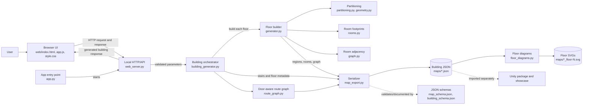
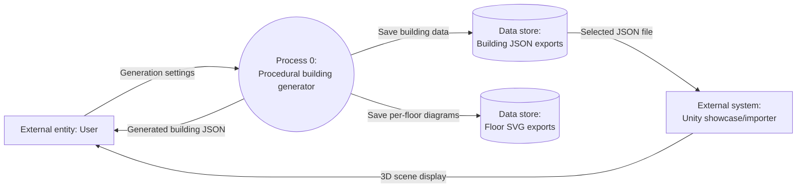
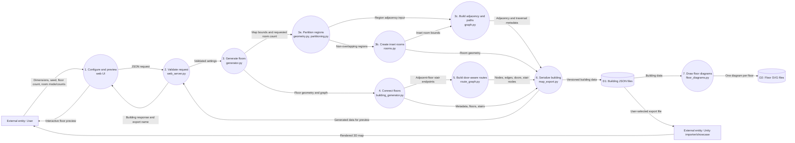

# Project UML and Data Flow Diagrams

These diagrams describe the V2 application in this folder. The browser generator runs locally. Unity is a downstream consumer of exported JSON and is not part of the browser request path.

## 1. UML component diagram



## 2. UML sequence diagram: generate a building

```mermaid
sequenceDiagram
    actor User
    participant UI as Browser UI
    participant Server as web_server.py
    participant BG as building_generator.py
    participant Floor as generator.py and floor modules
    participant Route as route_graph.py
    participant Export as map_export.py
    participant Diagram as floor_diagrams.py
    participant Disk as maps/ output directory

    User->>UI: Enter dimensions, seed, floors, room counts
    UI->>Server: POST /api/generate with settings
    Server->>Server: Parse and validate values
    Server->>BG: generate building(seed, size, floors, room plan)
    loop For each floor
        BG->>Floor: build_floor(floor seed, size, room count)
        Floor->>Floor: Partition map into exact-count regions
        Floor->>Floor: Shrink regions to room footprints
        Floor->>Floor: Build room adjacency and traversal paths
        Floor-->>BG: Regions, rooms, graph, DFS path
    end
    BG->>BG: Select and validate stair landings between floors
    BG->>Route: Add door-aware route graph to each floor
    Route-->>BG: Nodes, edges, door and stair-node metadata
    BG-->>Server: Complete building data
    Server->>Export: Serialize versioned building JSON
    Export->>Disk: Write building JSON
    Server->>Diagram: Render one SVG per floor
    Diagram->>Disk: Write floor SVG files
    Server-->>UI: Return building data and export filename
    UI-->>User: Preview floors and routes; show export result
```

## 3. DFD context diagram (Level 0)



## 4. DFD detailed diagram (Level 1)



### Diagram notes

- A fixed seed and identical inputs reproduce a layout under the same generator version.
- A building with *N* floors has *N−1* stair transitions.
- JSON and SVG files are written under `maps/`; the browser preview is returned directly by the API.
- The Unity flow starts after export/import. It consumes the building JSON; it does not call the browser server during ordinary map generation.
